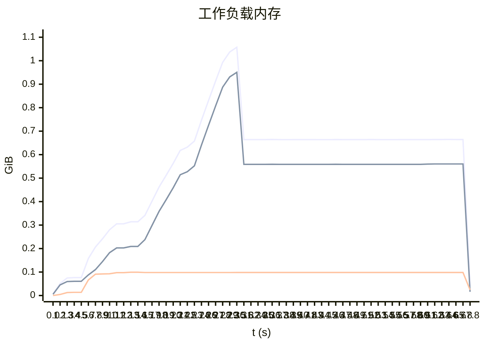
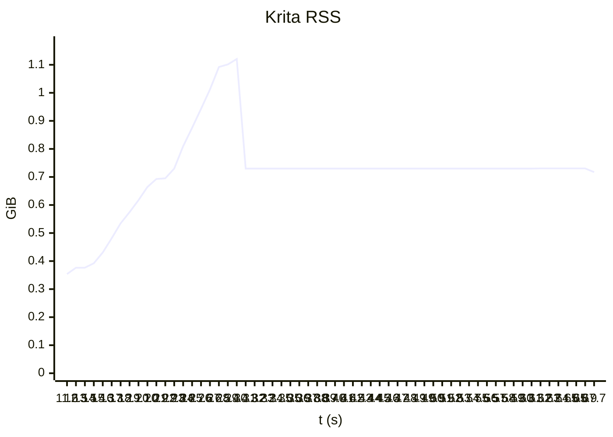
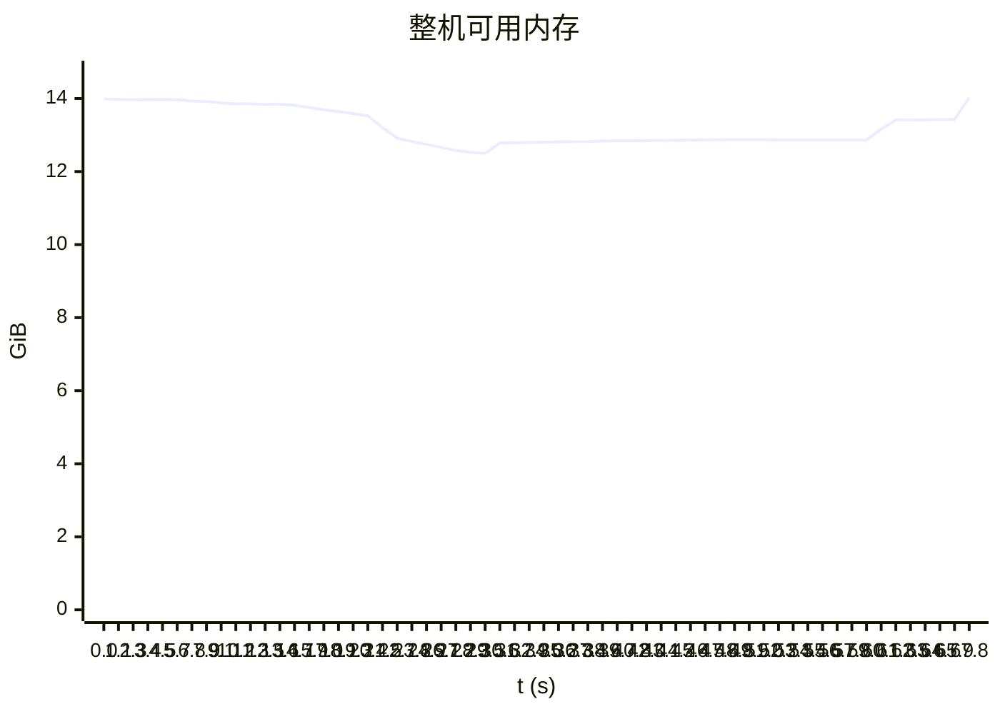
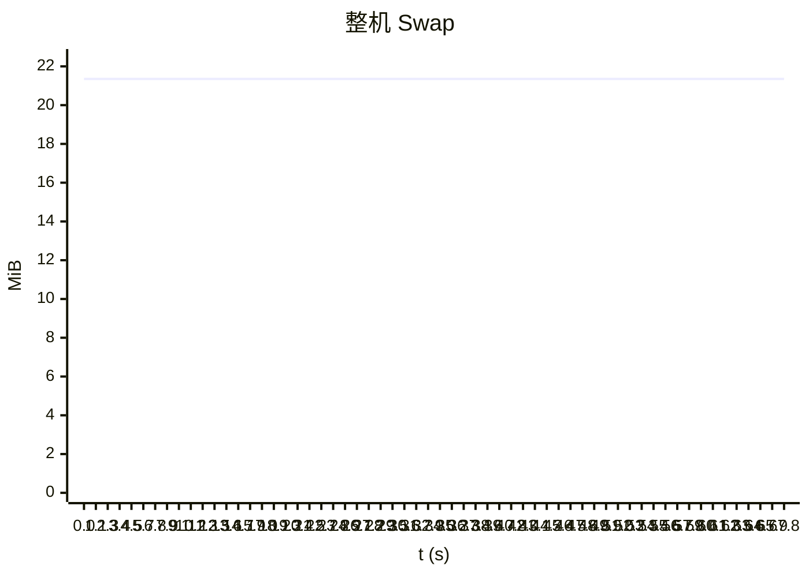
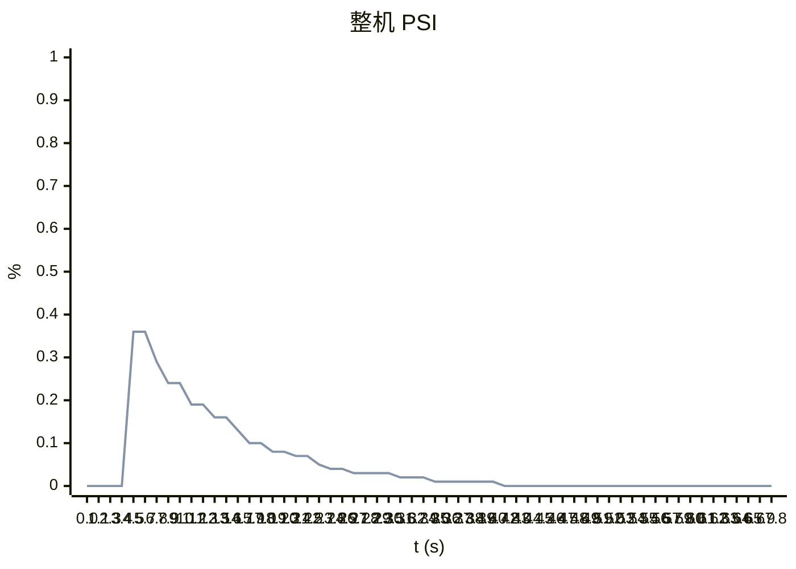
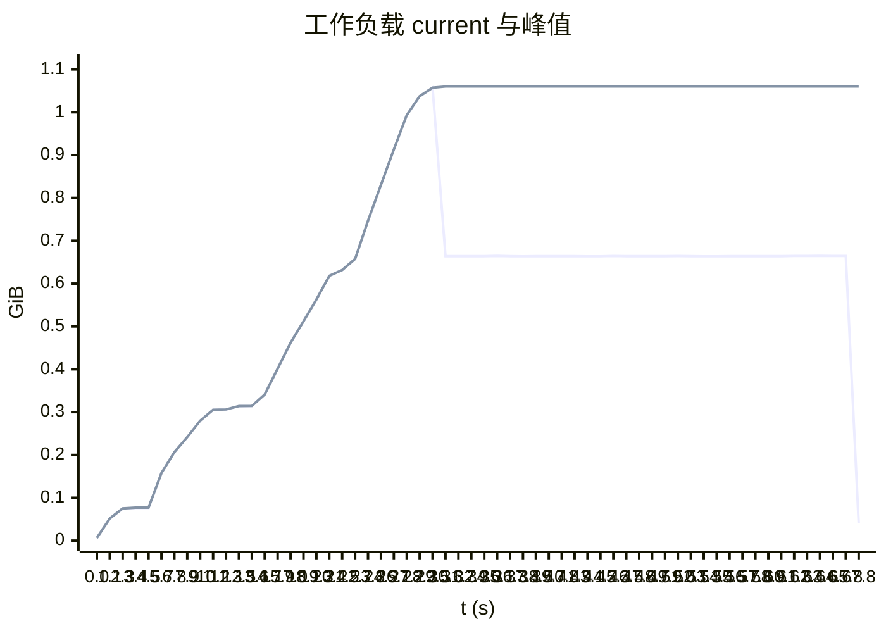

# 本轮实测曲线

批次 `krita_three_guard_20261128_010241_2cb959a6`，run ID `717be1060cc54a55ae1c93d0dee082f8`。代码 `715afeaf0644d35da3cb207ab211dbaa85f75b6a`，配置 SHA256 `c6b19c657518b3ca754f7dd4474e973c878bc590183d60fb37fa89c7bd88b6f5`。

GitHub 中直接渲染曲线。每条图最多显示 60 个实测点，简图会连接所选样本。完整 PNG 在超过 500 ms 的缺口处断线，文件和原始数据保存在 VM。阶段边界见 [时间线](phase_timeline.md)。

### 工作负载内存

线条顺序 `memory_current`, `stat_anon`, `stat_file`。

### Krita RSS

线条顺序 `krita_vm_rss_bytes`。

### 整机可用内存

线条顺序 `mem_available_bytes`。

### 整机 Swap

线条顺序 `host_swap`。

### 整机 PSI

线条顺序 `global_psi_full_avg10`, `global_psi_some_avg10`。

### 工作负载 current 与峰值

线条顺序 `memory_current`, `memory_peak`。

