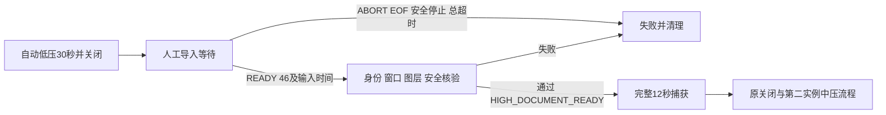

# 46层 ORA 人工导入确认

本次改造只替换高压46层文档的打开确认；开发验收不启动Krita或正式采集。正式运行须在用户审核后另行发起。

## 配置与运行边界

新增 `configs/collection.rapid-9000-manual-high-import.json`，按当前VM上一轮的实际配置复制，唯一行为字段差异是 `automation.manual_high_import=true`。原部署配置、其他模板及前三轮结果不覆盖。该开关仅允许prepared_document为46层、9000×9000的timed_window实验；不设置开关的旧模式保留，用于兼容与回归。

Krita5.0.2、46层素材及SHA256、原7层中压素材、tile67%、低压30秒、高压12秒、中压30秒、50ms采样、最大500ms缺口、全部安全阈值和1800秒整体上限保持原值。open_timeout_s仍160，继续用于原自动低压/中压打开；人工等待不套用这个超时，也不把它增加到600秒。整体运行上限从原采集器启动门开始约束，人工等待和核验都包含在内，不能无限等待。

人工导入目标：

```text
/home/mxt/TeamOOM/assets/baseline_assets/foreground/krita/rapid_9000_generated_20261127_154636/OOM_assets/krita_rapid_9000_46/layered_9000_46.ora
size = 124404893
sha256 = 100c151300f505b83a108d6c36b1a912251b020e7170945fc504274415e0bb8a
```

## 交互流程

1. 在VM的真实前台终端启动原 `scripts/collect_krita.py`，选择新增配置和新的外部结果目录。不能重定向stdin、使用nohup/后台任务或通过非交互Codex工具假装输入。前台检查使用 `sys.stdin.isatty()`、字符设备和 `tcgetpgrp()==getpgrp()`；失败在启动业务应用前拒绝。
2. 自动启动、身份/窗口归属检查、低压打开、30秒浏览及关闭低压文档沿用原逻辑。
3. 前台显示 `[MANUAL IMPORT REQUIRED]` 与完整目标路径。用户在已启动的Krita中手动Ctrl+O，选择46层ORA，等待导入结束，检查画布和图层面板，然后返回终端。
4. 仅接受整行 `READY 46` 或 `ABORT`。错误输入重新提示；部分输入不确认；提示前排队的旧输入丢弃。ABORT或终端EOF进入原有安全停止/精确unit清理路径，不继续捕获。
5. READY收到时立即保存终端读取的实际monotonic/wall时间；不开始12秒。再次核验完整进程身份、唯一可见正常窗口、无残留文件/模态框、AT-SPI及图层数，并等待采样器对新一轮parent/workload样本完成原安全检查。
6. 核验通过发出HIGH_DOCUMENT_READY，从该时点完整捕获12秒。核验失败发出HIGH_DOCUMENT_READY_FAILED并停止，不能发出成功事件或进入中压。
7. 成功后原关闭第一实例、验证正常退出、第二实例、自动7层文档、中压30秒、退出、清理、封存及验证流程保持原样。异常unit清理释放不能当作自然业务释放。



## 终端、采样与安全检查的分工

systemd worker内的自动化原本没有交互stdin。生产实现不分配伪终端、不把文件或管道伪装为TTY：只有前台collector读取用户的真实stdin。一个独立输入线程使用select/os.read轮询，通过本run的请求/应答文件转交输入及原始时间戳。GUI自动化继续独立运行，采样主循环没有readline、input或等待用户的阻塞调用。终端线程在封存前停止。

自动化每次人工等待轮询都验证原Popen仍存活、PID、PPID、starttime、完整executable和cgroup，并检查停止请求与原整体截止时间。原50ms采样、OOM/PSI/Swap/内存保护持续工作。READY核验的安全应答只在两种scope都取得请求之后的新样本、通过原enforce/OOM/持续PSI检查并写CSV后产生；另核对原磁盘余量阈值。应答超过500ms或无法对应原CSV时拒绝放行。未删除或放宽任何身份/cgroup守卫。

## 证据与验证等级

所有新协议文件都在新run目录，随原manifest.sha256封存，不进入Git：manual-terminal.json、manual-import-request.json、manual-import-response.json、manual-safety-request.json、manual-safety.json，以及krita/high-document-manual-evidence.json。

READY证据保存完整wmctrl stdout、本PID窗口的xprop与xwininfo、当前活动窗口ID及其xprop、AT-SPI stdout/stderr/解析快照、核验前后完整身份、Layers观测值、标题匹配结果与安全应答。用户返回终端后活动窗口可以是终端；这只作为证据保存，不向终端发送GUI输入。

| 结果 | 处理与报告 |
|---|---|
| 唯一Layers表=46，标题匹配，其他检查通过 | MACHINE_VERIFIED；机器独立核对层数和文档名，仍保留用户确认记录 |
| AT-SPI无法提供唯一层数，其他检查通过 | MACHINE_LAYER_CHECK_UNAVAILABLE；document_verification=USER_CONFIRMED，不标作机器成功 |
| 层数=46但标题不匹配 | 保存实际标题、title_matches_expected=false，document_verification=USER_CONFIRMED |
| 机器明确读到非46层、窗口/身份不符、模态框或安全失败 | FAILED，停止；人工READY不能覆盖 |
| 没有完成核验、没有成功/明确失败结果 | NOT_VERIFIED，流程不完整，不能通过完整实验验收 |

机器独立核对范围是可访问性层数、窗口标题和所有权；画布正常显示仍来自用户目视确认。多个Layers表不能冒充唯一机器结果；已知错误层数即使伴随其他AT-SPI错误也不能退回人工放行。

验证器在新模式中增加原始证据、终端来源、字段一致性和安全样本时间校验，并区分以上等级。原8阶段、正常退出、原峰值/平台验收、50ms/500ms、OOM/PSI与封存规则仍执行；不能用READY消除其他失败。计时结束事件的import_verified=false仍保留，表示经过12秒本身不是层数证明。

## 事件和五个时间点

| 事件 | monotonic_ns / wall_time_ns 的含义 |
|---|---|
| HIGH_DOCUMENT_MANUAL_IMPORT_START | 关闭低压文档之后，开始人工等待 |
| HIGH_DOCUMENT_USER_READY | 终端线程实际收到READY整行的原时间，跨进程原样保留 |
| HIGH_DOCUMENT_MACHINE_VERIFY_START | 自动化实际开始READY核验 |
| HIGH_DOCUMENT_MACHINE_VERIFY | 身份/窗口/图层及新安全应答核验结束 |
| HIGH_DOCUMENT_READY | 核验通过后正式12秒起点；不能回填为输入或开始导入时刻 |
| CAPTURE_WINDOW_START / CAPTURE_WINDOW_DONE | 捕获函数实际进入/退出时间；origin_monotonic_ns必须指向HIGH_DOCUMENT_READY，结束不得早于origin+12秒 |
| HIGH_DOCUMENT_READY_FAILED | 确认/核验失败，附原错误，不允许有后续成功捕获 |

新HIGH_DOCUMENT事件共同字段至少包括：run_id、request_id、expected_asset、expected_sha256、expected_layers、user_confirmation、manual_wait_duration_s、monotonic_ns、wall_time_ns、krita_pid、window_id、actual_window_title、machine_layer_count、machine_verification_status、process_identity_status、document_verification。未知值明确为null/NOT_VERIFIED；不编造已知值。

USER_READY后保留user_ready_monotonic_ns/user_ready_wall_time_ns；核验结果保留verification_started_monotonic_ns/wall_time_ns，READY再记录verification_finished_monotonic_ns/wall_time_ns。正式高压统计窗口同样从HIGH_DOCUMENT_READY起算，人工等待和核验不混入12秒高压统计，整个原始时间序列仍完整保存。

## 离线验收

`tests/test_manual_import.py`使用虚拟时钟、模拟进程/窗口/AT-SPI、测试私有PTY和fake kernel。生产代码没有创建PTY。覆盖READY/ABORT、非TTY/后台TTY拒绝、错误及部分输入、完整身份字段变化、层数不符、标题不匹配、AT-SPI不可用、模态与多主窗口、原安全停止、200秒人工等待与1800秒总时限、核验后完整12秒、机器/人工证据防混淆、原安全应答及低压/第二实例/中压流程回归。

真实前台PTY子进程测试不mock前台TTY检查，确认输入转交到正确run；另在等待输入时以50ms读取测试私有fake kernel，确认输入等待不阻塞采样。它们都是离线功能测试，不代表已测得真实Krita负载的采样性能或导入成功。

运行原有项目与专项测试时设置测试私有XDG_RUNTIME_DIR，防止锁文件写入沙箱只读/run；不修改生产measurement_lock。完整专项测试包含“源码必须干净”的原有断言，需在代码提交后运行；不删除或mock该断言来伪造通过。
